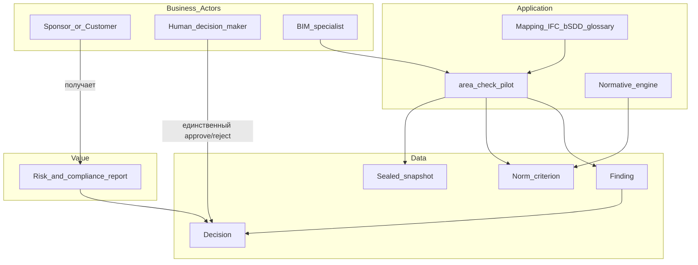

# ArchiMate — контекст AVGALAXY (v0.1)

Слои упрощённо (витрина; не полный Tobit).

**Метрика успеха (одна):** площадь по норме проверена **без ручного пересчёта** — след: snapshot + criterion + finding + human decision.

**Читается за 30 сек:** пользователь/специалист гоняет пилот → finding → **человек решает** → спонсор получает отчёт о соответствии/риске.  
Finding без human decision не «закрыт». `geometry_basis` явен (не вид экрана).
