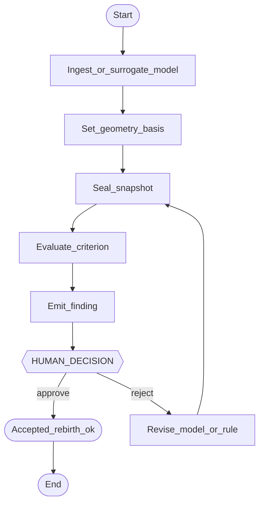

# BPMN 2.0 — контур нормативной проверки (v0.1)

**Метрика успеха:** площадь проверена без ручного пересчёта (след в finding + decision).

**Стоп-точка за 30 сек:** жирный шлюз `HUMAN_DECISION` — единственный путь к Accept. До него нет rebirth/accept.

**События:** snapshot immutable; смена отделки → новый snapshot.  
**Gateway:** только человек меняет `decision.status` с `pending_human`.
