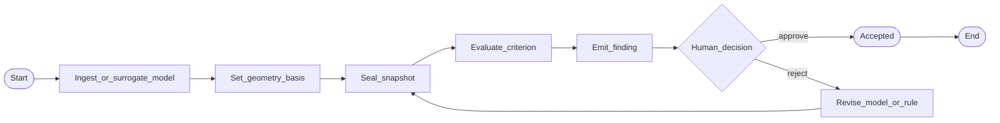

# BPMN 2.0 — контур нормативной проверки (v0)

Процесс пилота area-check (упрощённо).

**События:** snapshot immutable; смена отделки → новый snapshot, не правка старого.  
**Gateway:** только человек меняет `decision.status` с `pending_human`.
